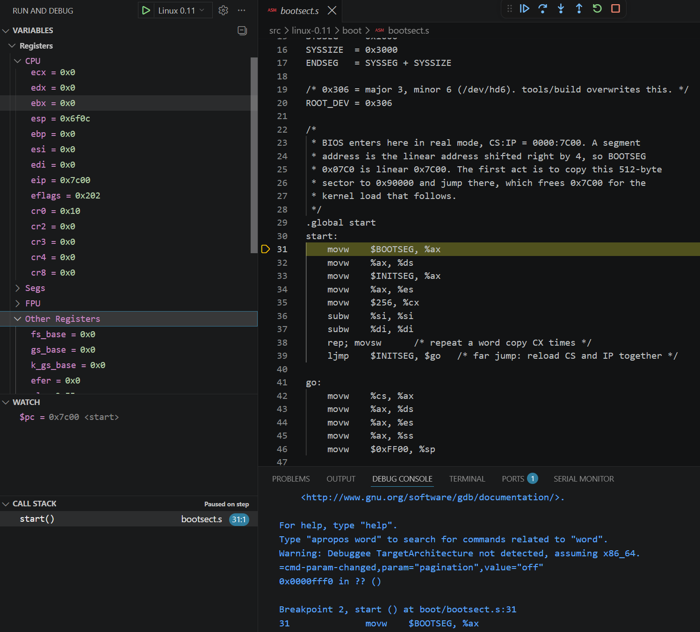
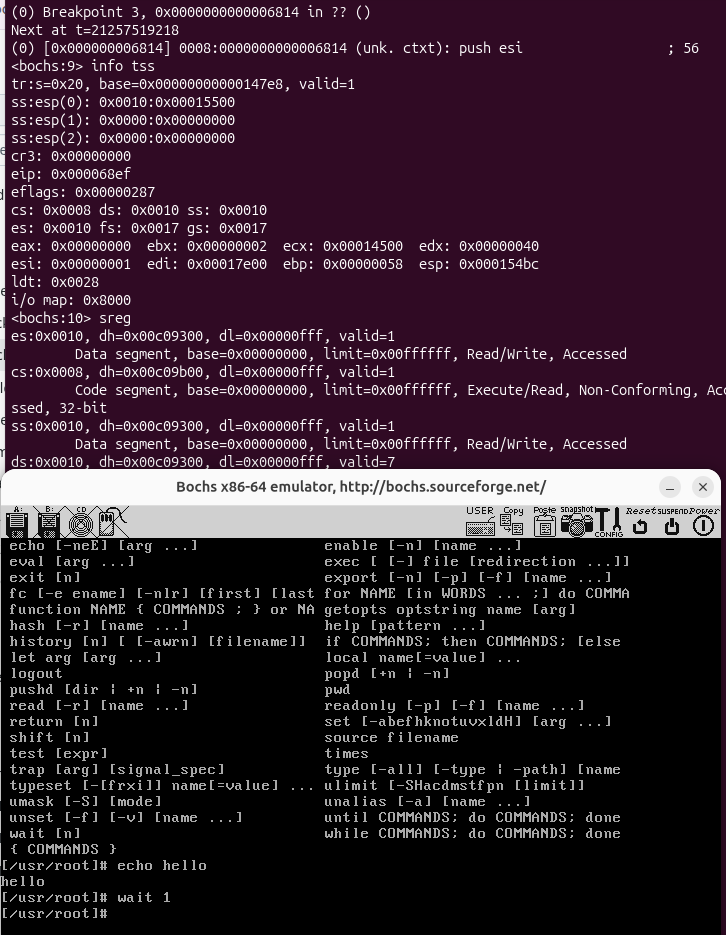
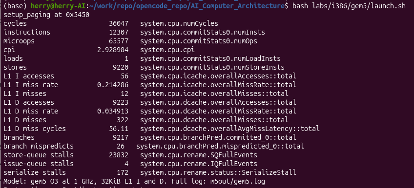
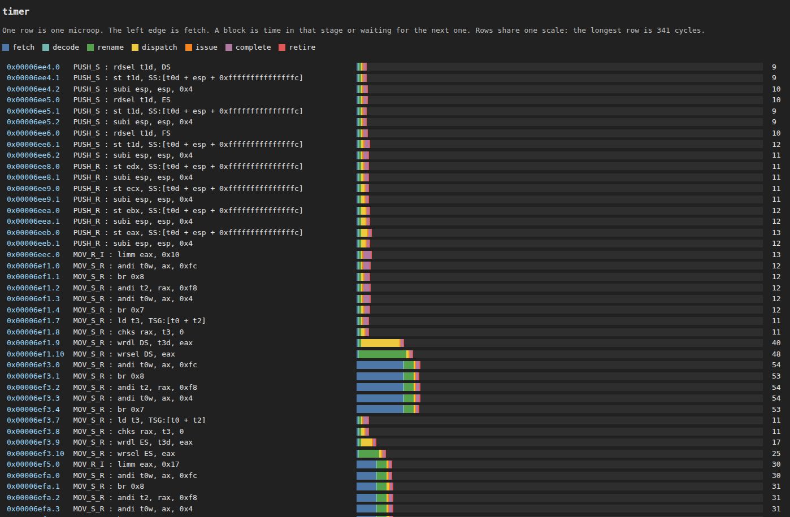

# 用 Linux 0.11 学习计算机体系结构

[English](README.md)

这个仓库面向想用 Linux 0.11 学习计算机体系结构的人。这份内核小到可以整份读完，写于 1991 年，面向 80386 和 PC 设备。学习时先把它接到当代计算机上，再顺着下面的路径看下去。

## 路径

1. **从原版读起。** `reference/linux-0.11/` 保存未经修改的 Linux 0.11。后面的改动都回到这里对照。
2. **在当代计算机上编译，并在 QEMU 里运行。** [这一步改了什么，以及为什么](docs/zh/build-and-qemu.md)。源码改到能用现在的工具链编译。改一行、重新编译，就可以观察操作系统在做什么：能否启动、系统调用是否返回、进程是否出现。
3. **在 Bochs 里看机器状态。** [看什么，以及怎么看](docs/zh/bochs.md)。同一个系统进入保护模式、响应中断、切换任务时，观察寄存器、GDT、IDT、页表和 TSS 的变化。
4. **在 gem5 里看执行代价。** [量什么，以及怎么量](docs/zh/gem5.md)。沿同一段内核路径，观察周期、cache miss 和流水线停顿。
5. **再看别的架构。** [virt 板上的 RV32](docs/zh/rv32.md)。x86 走通之后，保持内核短小，先加入 RISC-V，再加入 ARM，对照哪些属于某一种架构，哪些是操作系统本身。`src/rv32/` 是其中的第一份内核。

## 课程

### [同一批问题，换一台 CPU](docs/zh/course.md)

80386 先答，RV32 再答，ARM 还空着。

- 系统调用通过哪条指令陷入内核
- 上下文切换时，寄存器状态保存在哪里
- 哪个寄存器保存页表基址
- 定时器中断在哪个寄存器里给出原因
- […](docs/zh/course.md)

名字本身看不出作用的指令：

- [80386 内核里的指令](docs/zh/i386_instructions.md)
- [RV32 内核里的指令](docs/zh/rv32_instructions.md)

## 看起来是什么样

- 用 VS Code 和 QEMU 单步 Linux 0.11。

  

- 用 Bochs 看任务切换时，机器里有什么。

  

- 用 gem5 看填页表花了多少周期。

  

- 用 gem5 把一次时钟中断拆成流水线。

  

## 目录

| 路径 | 作用 |
| --- | --- |
| `reference/linux-0.11/` | 冻结的原版内核 |
| `src/linux-0.11/` | 要编译的 80386 内核 |
| `src/rv32/` | RV32 内核 |
| `src/riscv/` | RV32 和 RV64 共用的用户态入口 |
| `src/user/` | 盘上的程序：sh、ls、echo、sleep |
| `labs/` | 各步的启动脚本 |
| `script/bootstrap.sh` | 安装宿主工具 |
| `rootfs/` | 80386 的教学盘，保持下载 |

编辑器的文件树和搜索都不显示 `reference/`。对照 `src/linux-0.11/` 时，按这个路径打开。这份目录从 kernel.org Historic 的这个压缩包解出：

https://cdn.kernel.org/pub/linux/kernel/Historic/old-versions/linux-0.11.tar.gz

SHA256：`660997a6b1f03ee5aadce0ac806ffa653dedf1dea6d82c6731f9c9ddf0092673`

要和这份树比较，先核对 SHA256，再解压，把解出的 `linux-0.11` 目录与 `reference/linux-0.11/` 做 diff。

`rootfs/hdc-0.11.img` 来自 [hello-os/linux-0.11](https://github.com/hello-os/linux-0.11) 的 `rootfs/hdc-0.11.img.xz`。SHA256：`c83a9837f3f804882a76756f2ff46349467bdf66ed44e301a6c5e124f414b6d1`。大小：127631360 字节。这张盘保持下载，不在仓库里生成。生成的 `Image` 不纳入 git。

## 许可证

`reference/linux-0.11/` 是 Linus Torvalds 的 Linux 0.11（1991 年版权），这些文件保持其原有条款。仓库里的其他文件使用 Apache License 2.0，见 [LICENSE](LICENSE)。
