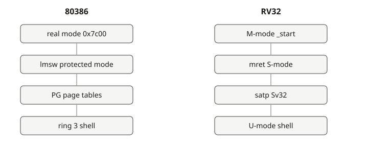
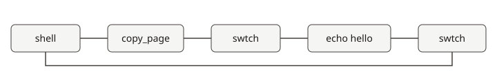
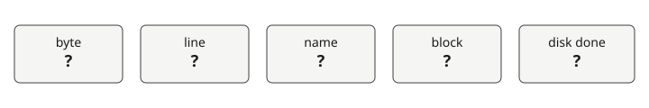

# The same questions, on another CPU

[中文](../zh/course.md)

Linux 0.11 walks these questions first. RV32 answers them again with its own functions. ARMv7 and AArch64 each have a kernel and a column. RV64 is the [register-width difference](course/rv64.md) inside this RISC-V course, not another column. Cycles and pipeline stalls stay in the 80386 [gem5](gem5.md) lab.

| Question | 80386 | RV32 | ARMv7 | AArch64 |
| --- | --- | --- | --- | --- |
| Where is the first instruction, and in which mode | `boot/bootsect.s`. F5 stops at `0x7c00` | [Reset](course/rv32.md#boot) | [SVC](course/armv7.md#boot) | [EL1](course/aarch64.md#boot) |
| What enters the mode the kernel keeps | [Protected mode](cases/protected-mode.md) | [mret](course/rv32.md#mode) | [Stay in SVC](course/armv7.md#mode) | [Stay at EL1](course/aarch64.md#mode) |
| Which register names the page-table root | [Paging](cases/paging.md) | [satp](course/rv32.md#pages) | [TTBR0](course/armv7.md#pages) | [TTBR0_EL1](course/aarch64.md#pages) |
| What separates user and kernel | After the shell is up, Bochs `sreg` shows CS with the low bits equal to 3. See [Bochs](bochs.md) | [U-mode](course/rv32.md#privilege) | [User mode](course/armv7.md#privilege) | [EL0](course/aarch64.md#privilege) |
| Where the timer cause appears | [Timer interrupt](cases/timer.md) | [scause](course/rv32.md#timer) | [GIC 30](course/armv7.md#timer) | [GIC 30](course/aarch64.md#timer) |
| Which instruction enters the kernel, and where the call number sits | `system_call` in `kernel/system_call.s`, vector `0x80` | [ecall](course/rv32.md#ecall) | [svc, r7](course/armv7.md#ecall) | [svc, x8](course/aarch64.md#ecall) |
| Where the two tasks keep their registers, and which instruction switches | [Task switch](cases/schedule.md) | [swtch](course/rv32.md#switch) | [swtch](course/armv7.md#switch) | [swtch](course/aarch64.md#switch) |
| What copies 4KiB, and what makes that code run | [Copy one page](cases/copy-page.md) | [copy_page](course/rv32.md#copy) | [1024 words](course/armv7.md#copy) | [512 words](course/aarch64.md#copy) |
| How a byte arrives from a device | `kernel/chr_drv/keyboard.S`, vector `0x21` | [uart_getc](course/rv32.md#byte) | [PL011](course/armv7.md#byte) | [PL011](course/aarch64.md#byte) |
| How that byte becomes a line | `kernel/chr_drv/tty_io.c` | [read_line](course/rv32.md#line) | [read_line](course/armv7.md#line) | [read_line](course/aarch64.md#line) |
| How a name finds a block | `fs/namei.c` | [lookup](course/rv32.md#name) | [lookup](course/armv7.md#name) | [lookup](course/aarch64.md#name) |
| Whether the same block is still in memory the second time | `bread` in `fs/buffer.c` | [bread](course/rv32.md#block) | [bread](course/armv7.md#block) | [bread](course/aarch64.md#block) |
| What wakes the waiter when the disk finishes | `kernel/blk_drv/hd.c`, vector `0x2E` | [virtio_isr](course/rv32.md#disk) | [GIC 48](course/armv7.md#disk) | [GIC 48](course/aarch64.md#disk) |

The RV32 stops are in [the RV32 pass](course/rv32.md), the ARMv7 stops in [the ARMv7 pass](course/armv7.md), and the AArch64 stops in [the AArch64 pass](course/aarch64.md). The third picture is the last five questions.
