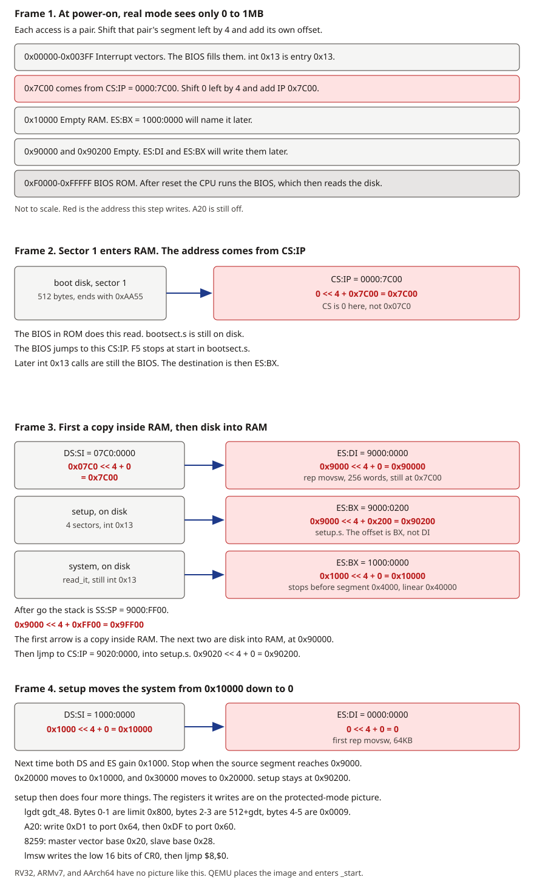
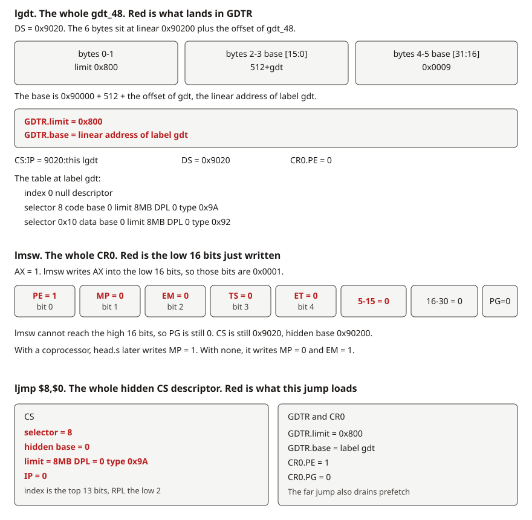
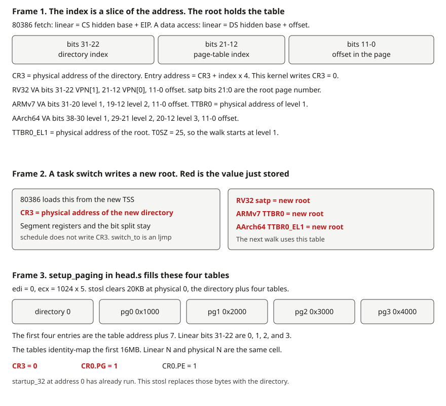
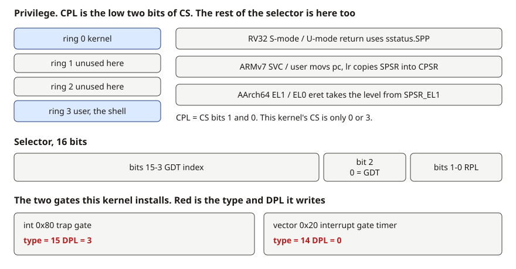
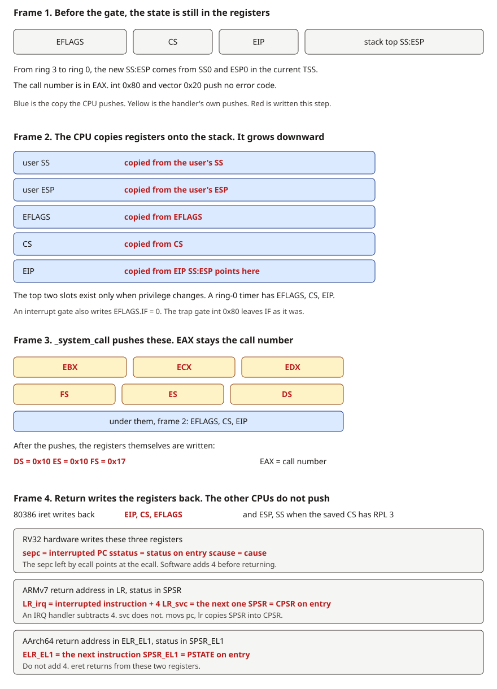
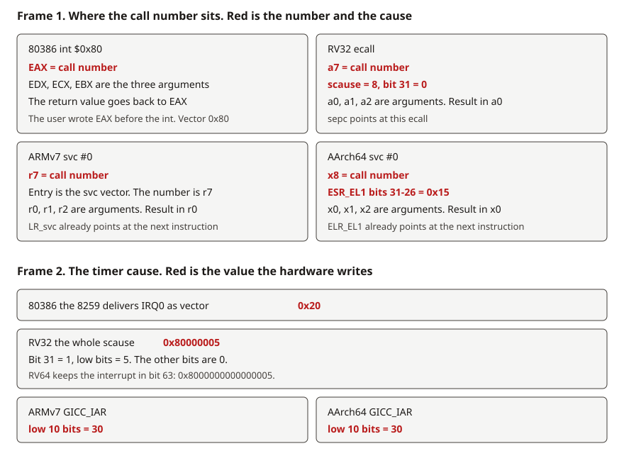
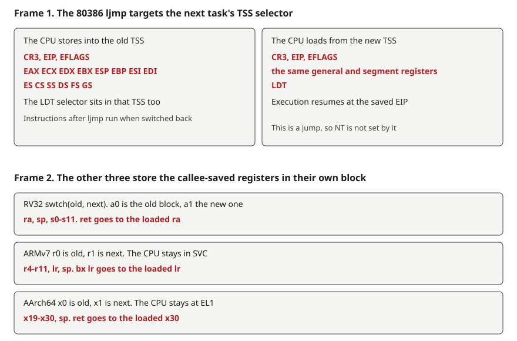
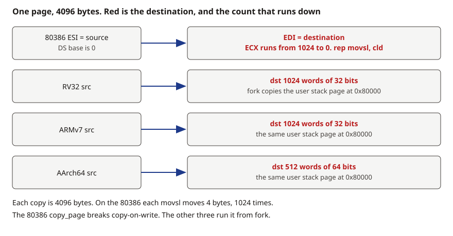
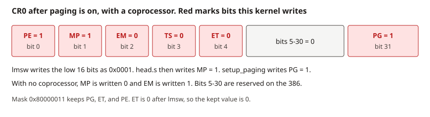
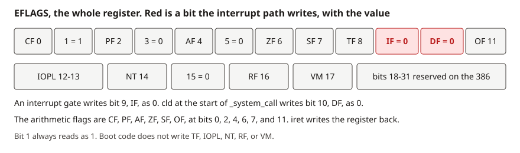

# Mechanism pictures

[中文](../zh/mech.md)

[Question list](course.md)

One frame is one action. On this page the frames are stacked, so reading downward is the flip. To hold a frame, open the [pager](../../figures/view.html?fig=real-mode). The boot picture names who moves each block, and from which address to which address.

## Real mode, 1MB

An 80386 powers up in real mode. One access is a pair. The offset is not always IP. Instruction fetch is CS:IP, a string source is DS:SI, its destination is ES:DI, and the stack is SS:SP. The linear address is that pair's segment shifted left by 4, plus its own offset. Both halves are 16 bits and the address bus is 20 bits, so multiplying by 16 is a shift of 4. The visible space is 0 through `0xFFFFF`, one megabyte. Address line A20 is still off, and a store above 1MB wraps back into that megabyte.

After reset the CPU runs the BIOS in ROM, from `0xF0000` through `0xFFFFF`. The BIOS fills the interrupt vector table at the bottom of memory, 0 through `0x3FF`. The disk service hangs off [`int 0x13`](i386_instructions.md#int). The BIOS then reads sector 1 of the boot disk, 512 bytes, the last two of them `0xAA55`, and places it at linear `0x7C00`. The BIOS jumps to CS:IP = `0000:7C00`: CS is 0 and IP is `0x7C00`. `0x07C0` is not CS yet. F5 stops on the next instruction, `start` in `bootsect.s`. The BIOS did the read. `bootsect` has not run yet.

The first act of `bootsect` is to move itself. Still at CS:IP = `0000:7C00`, it runs [`rep movsw`](i386_instructions.md#rep-movsw). The source is DS:SI = `07C0:0000` and the destination is ES:DI = `9000:0000`. `07C0:0000` and `0000:7C00` name the same cell. `CX` is 256 words, 512 bytes. The next instruction, [`ljmp`](i386_instructions.md#ljmp-real) `$0x9000, $go`, makes CS:IP = `9000:go`. At `go` it writes DS, ES, and SS with `0x9000` and SP with `0xFF00`, so the stack is SS:SP = `9000:FF00`. That linear address is `0x9000` shifted left by 4, plus `0xFF00`, which is `0x9FF00`. The low addresses are now free for the kernel.

The same `bootsect`, now running at `0x90000`, calls `int 0x13` with `AH=2` (read sectors). The destination pair this time is ES:BX, not ES:DI. ES:BX = `9000:0200`, and the BIOS places the next 4 sectors at `0x90200`. That is `setup.s`. `SETUPLEN` is 4. `read_it` keeps calling `int 0x13` with ES:BX = `1000:0000` and places the system image at `0x10000`. The destination segment starts at `0x1000` and grows until `ENDSEG` (`0x4000`, linear `0x40000`). `SYSSIZE` is `0x3000` paragraphs of 16 bytes, 192KB. Then `ljmp $0x9020, $0` enters `setup.s`.

`setup` runs at `0x90200`, still in real mode. It asks the BIOS, through `int 0x10` and `int 0x15`, for the cursor, the memory above 1MB, and the video parameters, and stores them at the start of `0x90000`, where `main` later reads them. `do_move` then carries the system image from `0x10000` down to physical 0. Each `rep movsw` uses `CX` of `0x8000` words, 64KB. The first copy is `0x10000` to 0, the second is `0x20000` to `0x10000`, and each block steps one lower. The loop stops when the source segment reaches `0x9000`, so the `bootsect` at `0x90000` and the `setup` at `0x90200` stay put.

`setup` then does four more things. [`lgdt`](i386_instructions.md#lgdt) loads a temporary GDT: a null descriptor at index 0, code selector 8, data selector `0x10`, both with base 0 and a 4KB-granularity limit that covers 8MB. It writes `0xD1` and `0xDF` to the 8042 ports `0x64` and `0x60`, which turns A20 on, so addresses above 1MB no longer wrap. It moves the two 8259 controllers off the BIOS vector base `0x08`, to `0x20` on the master and `0x28` on the slave, clear of the CPU's own exception numbers. [`lmsw`](i386_instructions.md#lmsw) writes the low 16 bits of [CR0](i386_instructions.md#cr0) as `0x0001`, and [`ljmp $8, $0`](i386_instructions.md#ljmp) enters `head.s`, which now sits at physical 0. Paging is still off. `head.s` later covers the instructions at address 0, which have already run, with the page directory. That is the paging section below. Red on the picture is the new value that step writes.

RV32, ARMv7, and AArch64 have no BIOS and no copy through `0x7C00`. QEMU places the image at its link address and enters `_start`.

The first arrow of frame 3 is [`rep movsw`](i386_instructions.md#rep-movsw): DS:SI (`07C0:0000`) to ES:DI (`9000:0000`). The next two arrows are disk into RAM through [`int 0x13`](i386_instructions.md#int), and the destination is ES:BX.

[Page this picture](../../figures/view.html?fig=real-mode)

## Registers after the far jump

`setup.s` does this, still running at `0x90200`, with DS already `0x9020`. Each of the three instructions writes a different register. The picture shows the whole record. Red is the field that instruction writes. The bit meanings are on [CR0](i386_instructions.md#cr0).

[`lgdt gdt_48`](i386_instructions.md#lgdt) reads 6 bytes from memory and writes GDTR. Those 6 bytes are [gdt_48](i386_instructions.md#gdt48): limit `0x800`, base bits 15:0 equal to `512+gdt`, base bits 31:16 equal to `0x0009`. Together they name the linear address of the label `gdt`. The GDT itself is at that label. `gdt_48` is only the record loaded into GDTR. The new values are GDTR.limit = `0x800` and GDTR.base equal to the label `gdt`.

[`lmsw`](i386_instructions.md#lmsw) writes AX into the low 16 bits of CR0. AX is 1, so the low 16 bits become `0x0001`: PE is 1, and MP, EM, TS, and ET are 0. The high 16 bits stay, so PG is still 0. CS is still the real-mode value `0x9020`, and the hidden cache has not been refilled. A 286-era `lmsw` cannot clear PE again.

The next instruction has to be the far jump [`ljmp $8, $0`](i386_instructions.md#ljmp). The top 13 bits of selector 8 are GDT index 1, and the low two bits, the RPL, are 0. The CPU reads that descriptor through GDTR and loads base 0, the limit, and DPL 0 into the hidden cache of CS. The new values are CS = 8, hidden base = 0, and IP = 0. The far jump also drains the prefetch queue, so the following bytes are decoded as 32-bit instructions. Those bytes are `head.s`, just moved to physical 0.

On entry, `head.s` writes `0x10` into DS, ES, FS, and GS. Writing a selector is what makes the CPU reload that register's hidden cache from the GDT. `lss` loads SS and ESP together. `setup_gdt` then executes only `lgdt`, installing the kernel GDT whose limit covers 16MB, and the data selectors are written again. CS is not written in these instructions. It keeps the descriptor the far jump cached on entry to `head.s`.

[Page this picture](../../figures/view.html?fig=segments)

## Page tables

The four CPUs do one walk. The root register is [CR3](i386_instructions.md#mov-cr3), [`satp`](rv32_instructions.md#satp), [TTBR0](armv7_instructions.md#ttbr0), or [TTBR0_EL1](aarch64_instructions.md#ttbr0-el1). The root holds the physical address of the table. The directory index is a slice of the address being translated. On the 80386, instruction fetch forms the linear address as the hidden base of CS plus EIP, and a data access uses the hidden base of DS plus the offset. The directory index is bits 31 through 22, the page-table index is bits 21 through 12, and the offset in the page is bits 11 through 0. The directory entry sits at CR3 plus the index times 4. On RV32 the directory index is virtual-address bits 31 through 22. On ARMv7 the level-1 index is VA bits 31 through 20. On AArch64, T0SZ is 25, the walk starts at level 1, and that index is VA bits 38 through 30. The second frame is a task switch: the root register is replaced, and the next walk uses the new table.

On the 80386 the filler is `setup_paging` in `head.s`. `stosl` clears 20KB at physical 0, the directory plus four page tables. The directory is at 0, `pg0` at `0x1000`, `pg1` at `0x2000`, `pg2` at `0x3000`, and `pg3` at `0x4000`. The first four directory entries point at those tables with the low three bits set to 7: present, writable, and user. The tables are an identity map of the first 16MB, so linear N and physical N are the same cell. CR3 is then written with 0, and [CR0](i386_instructions.md#cr0) bit 31 ([PG](i386_instructions.md#pg)) is set. `startup_32` lived at address 0 and those instructions have already run; this `stosl` replaces them with the directory. The `ret` returns and also drains the prefetch queue, so bytes fetched before PG was set are not executed as instructions.

A task switch on the 80386 does not have `schedule` write CR3 itself. `switch_to` is an `ljmp` aimed at the next task's TSS selector. The CPU stores the current registers into the old TSS, then loads CR3, the registers, and the LDT from the new TSS, and resumes at the EIP saved there. The instructions after `ljmp` run when this task is switched back to. RV32 writes `satp`, ARMv7 writes TTBR0, and AArch64 writes TTBR0_EL1. On those three the software stores the root register. The bits this kernel writes are on the [RV32](rv32_instructions.md#satp), [ARMv7](armv7_instructions.md#sctlr), and [AArch64](aarch64_instructions.md#tcr-el1) instruction pages.

[Page this picture](../../figures/view.html?fig=mmu)

## Privilege

On the 80386, CPL is the low two bits of CS, the level of the instruction now running. DPL sits in the segment or gate descriptor and is the level required to use it. RPL is the low two bits of a selector, the level this request claims. For a data segment, the numerically larger of CPL and RPL must be less than or equal to the DPL. An `int` instruction compares the gate DPL with CPL: the gate DPL must be greater than or equal to CPL.

This kernel's CS is only 0 or 3. Rings 1 and 2 exist on the machine, and this GDT holds no code segment for them. `set_system_gate(0x80)` installs a trap gate, type 15, with DPL 3, so ring 3 may execute `int $0x80`, and IF is left as it was. The timer uses `set_intr_gate(0x20)`, an interrupt gate, type 14, with DPL 0, and the CPU clears IF on entry. User code cannot invoke that vector. The 8259 delivers IRQ0 as vector `0x20`. On the way from ring 3 to ring 0 the CPU switches to the kernel stack and pushes the user's SS and ESP. `iret` pops them on the way back.

The three rows beside the rings are the same pair of levels on the other CPUs. RV32 uses S-mode and U-mode, and [`sret`](rv32_instructions.md#sret) honors SPP in [`sstatus`](rv32_instructions.md#sstatus). ARMv7 uses SVC and user; [`movs pc, lr`](armv7_instructions.md#movs-pc-lr) copies SPSR back into [CPSR](armv7_instructions.md#cpsr). AArch64 uses EL1 and EL0; [`eret`](aarch64_instructions.md#eret) takes the target level from SPSR_EL1.

[Page this picture](../../figures/view.html?fig=rings)

## What an interrupt saves

Blue is the return information the hardware leaves. Yellow is the general registers the handler pushes. Red is the value written in that step. The top of the stack is SS:ESP.

On the 80386, in the instant a gate is taken, the CPU pushes [EFLAGS](i386_instructions.md#eflags), CS, and EIP. Each slot is a copy of the register with the same name. A change from ring 3 to ring 0 first loads SS:ESP from SS0 and ESP0 in the current TSS, then pushes the user's SS and ESP. By the time `_system_call` runs, that hardware half is already on the stack. The call number is in EAX. The function then pushes DS, ES, and FS, then EDX, ECX, and EBX, which the C function receives as its three arguments. DS and ES become the kernel data selector `0x10`. FS becomes `0x17`, the user data selector in the current task's LDT, which is how the kernel reads and writes the caller's memory. `call _sys_call_table(,%eax,4)` indexes that table with the call number. On the way out, [`iret`](i386_instructions.md#iret) pops EIP, CS, and EFLAGS. If the saved CS has RPL 3, it also pops ESP and SS, back onto the user stack.

The timer arrives by the other path. After `setup` sets the master 8259 base to `0x20`, IRQ0 enters `_timer_interrupt` as vector `0x20`. The handler finds EFLAGS, CS, and EIP already pushed, saves registers itself, increments `jiffies`, writes the EOI, calls `do_timer`, and returns with `iret`.

RV32 does not push the return address. The hardware writes the interrupted PC into `sepc`, the status into `sstatus`, and the cause into [`scause`](rv32_instructions.md#scause). The `sepc` left by `ecall` points at the `ecall` itself, so the return path adds 4. The handler then stores the general registers in the trap frame. `sret` returns from `sepc` and `sstatus`.

ARMv7 leaves the return address in LR_svc for a system call, or in LR_irq for an interrupt, and the status in SPSR. LR_irq is 4 past the interrupted instruction, so the handler subtracts 4. LR_svc already points at the next instruction. `movs pc, lr` copies SPSR into CPSR. AArch64 leaves the return address in ELR_EL1 and the status in SPSR_EL1. ELR already points at the next instruction, so nothing adds 4. `eret` returns from those two registers.

[Page this picture](../../figures/view.html?fig=stack)

## Call number and cause

The call number is what the user stored before the trap. The cause is what the hardware writes on entry. Red on the picture is the number this step reads, and the value written into the cause register. The argument registers stay in the ordinary color.

On the 80386 the user executes `int $0x80`. The number is in EAX, the three arguments are in EDX, ECX, and EBX, and the return value is written back to EAX. The timer does not use that gate. The 8259 delivers IRQ0 as vector `0x20`.

On RV32 the user executes [`ecall`](rv32_instructions.md#ecall). The number is in a7, the arguments are in a0, a1, and a2, and the result comes back in a0. The hardware writes [`scause`](rv32_instructions.md#scause) as 8, with bit 31 clear. `sepc` points at that `ecall`. The timer writes `scause` as `0x80000005`: bit 31 is 1 and the low bits are 5. On RV64 the interrupt bit is bit 63, so the timer value is `0x8000000000000005`.

On ARMv7 the user executes `svc #0`. The number is in r7, the arguments are in r0, r1, and r2, and the result comes back in r0. Entry is the svc vector, and LR_svc already points at the next instruction. On AArch64 the number is in x8 and the arguments are in x0, x1, and x2. The hardware writes bits 31 through 26 of ESR_EL1 as `0x15`. ELR_EL1 already points at the next instruction. Both machines read the timer from GICC_IAR, and the low 10 bits are 30.

[Page this picture](../../figures/view.html?fig=syscall)

## Where a task switch puts the registers

On the 80386, `switch_to` is an [`ljmp`](i386_instructions.md#ljmp) aimed at the next task's TSS selector. The CPU stores CR3, EIP, EFLAGS, the general registers, and the segment registers into the old TSS, then loads that same set from the new TSS, plus the LDT, and resumes at the EIP saved there. The instructions after `ljmp` run when this task is switched back to. The switch is a jump, so it does not set NT. The new page-table root is the CR3 loaded here. That is the paging section above.

RV32, ARMv7, and AArch64 have `swtch` store a block itself. RV32 stores ra, sp, and s0 through s11, and `ret` goes to the loaded ra. ARMv7 stores r4 through r11, lr, and sp, and `bx lr` goes to the loaded lr, still in SVC. AArch64 stores x19 through x30 and sp, and `ret` goes to the loaded x30, still at EL1. Caller-saved registers are not in the block. The instruction that runs on the way back is the one after `swtch`.

[Page this picture](../../figures/view.html?fig=switch)

## Copying one page

All four move 4096 bytes. On the 80386, `copy_page` is `cld` followed by [`rep movsl`](i386_instructions.md#rep-movsl): ESI is the source page, EDI is the destination, and ECX runs from 1024 down to 0. The DS base is 0, so ESI is the linear address of the source page. Each `movsl` moves 4 bytes. It runs when copy-on-write breaks, after the caller has pointed the new page-table entry at the destination.

`copy_page` on RV32 and ARMv7 writes 1024 words of 32 bits. On AArch64 it writes 512 words of 64 bits. Those three call it from `fork` to copy the user stack page at `0x80000`.

[Page this picture](../../figures/view.html?fig=copy)

## CR0 and EFLAGS

Each bit is on [CR0](i386_instructions.md#cr0) and [EFLAGS](i386_instructions.md#eflags). These are the two strips.

