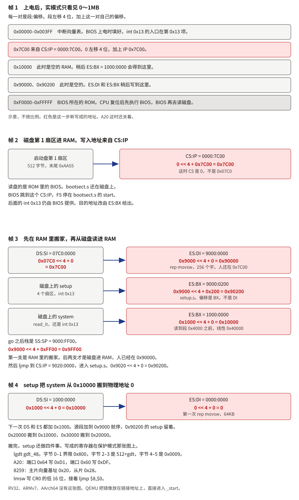
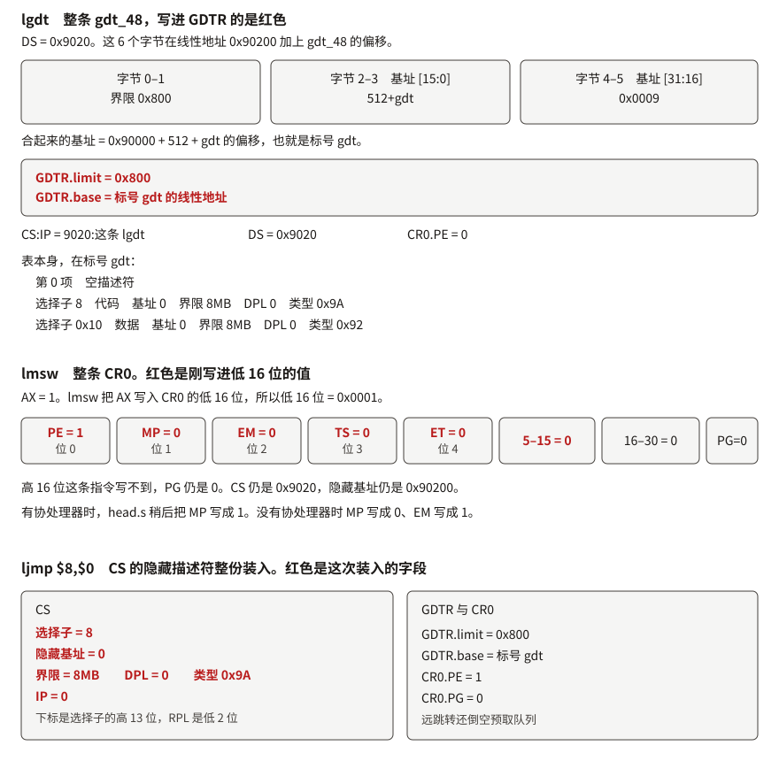
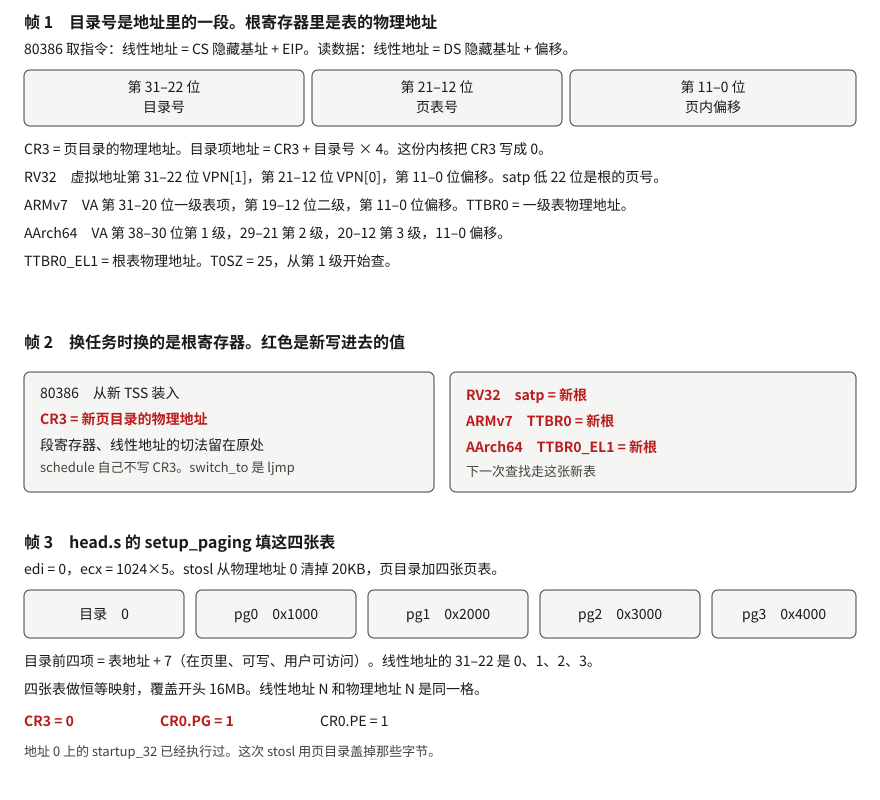
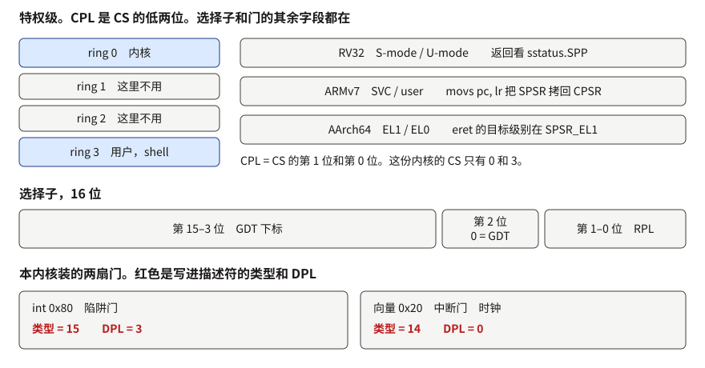
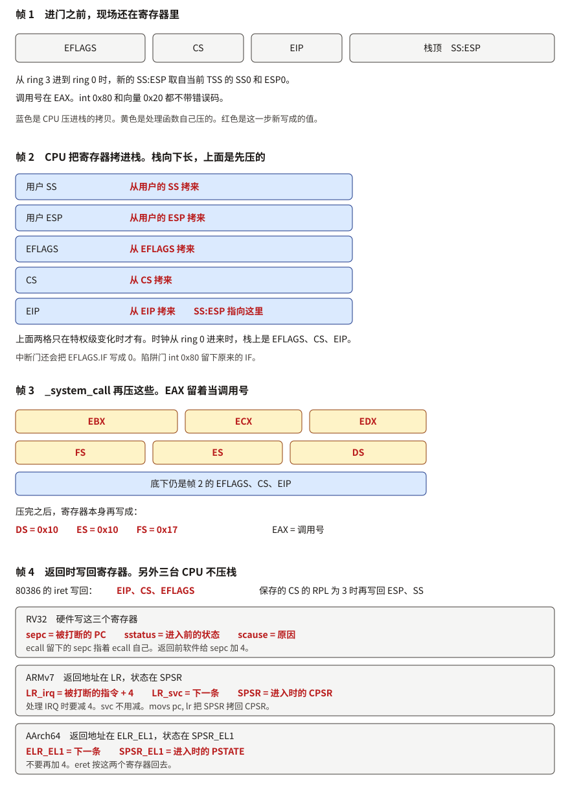
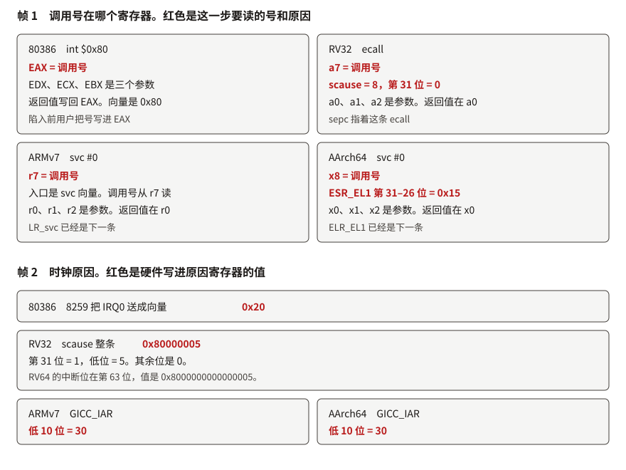
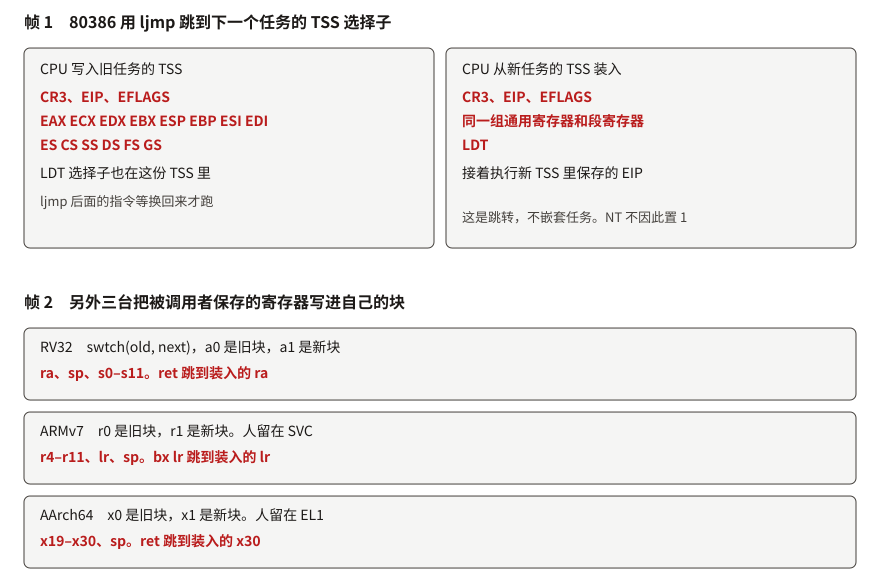
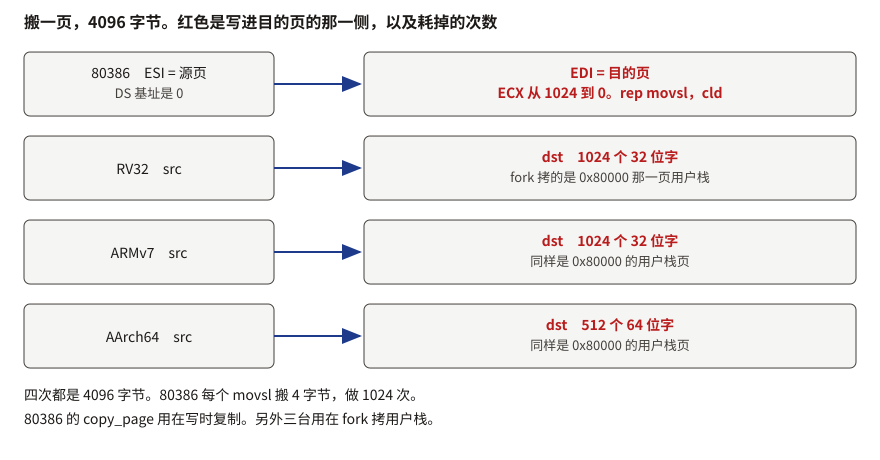
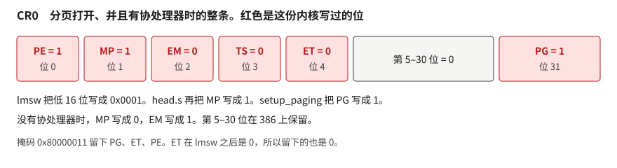
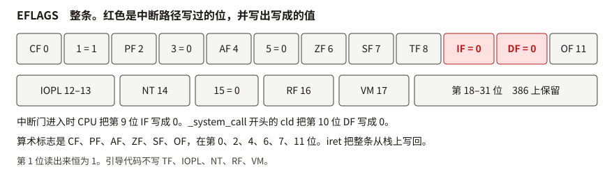

# 机制图

[English](../en/mech.md)

[问题表](course.md)

一帧一件事。页上的图把帧从上到下排开，读下去就是在翻。要停在某一帧，打开 [翻页](../../figures/view.html?fig=real-mode-zh)。图上写了谁在搬、从哪一格搬到哪一格。

## 实模式的 1MB

80386 刚上电时处在实模式。一次访问是一对寄存器，偏移不总是 IP。取指令是 CS:IP，串传送的源是 DS:SI、目的是 ES:DI，栈是 SS:SP。线性地址是这一对里的段寄存器左移 4 位，再加上它自己的偏移。段和偏移都是 16 位，地址总线是 20 位，乘 16 正好左移 4 位，能碰到的空间是 0 到 `0xFFFFF`，一共 1MB。第 20 位地址线 A20 还关着，写到 1MB 以上会折回这 1MB 里面。

CPU 复位后执行的是 ROM 里的 BIOS，在 `0xF0000` 到 `0xFFFFF`。BIOS 先填好内存最底端的中断向量表（0 到 `0x3FF`）。磁盘服务挂在 [`int 0x13`](i386_instructions.md#int) 上。然后 BIOS 从启动盘读出第 1 个扇区，512 字节，末两字节是 `0xAA55`，放到线性地址 `0x7C00`。BIOS 跳到 CS:IP = `0000:7C00`：CS 是 0，IP 是 `0x7C00`。`0x07C0` 此时还不是 CS。F5 停住的是这之后的第一条指令，`bootsect.s` 的 `start`。读盘的是 BIOS，`bootsect` 自己还没运行。

`bootsect` 的第一件事是把自己搬走。它还在 CS:IP = `0000:7C00` 上执行 [`rep movsw`](i386_instructions.md#rep-movsw)。源是 DS:SI = `07C0:0000`，目的是 ES:DI = `9000:0000`。`07C0:0000` 和 `0000:7C00` 是同一格。`CX` 是 256 个字，正好 512 字节。紧接着 [`ljmp`](i386_instructions.md#ljmp-real) `$0x9000, $go`，CS:IP 变成 `9000:go`。`go` 里再把 DS、ES、SS 都写成 `0x9000`，SP 写成 `0xFF00`，栈是 SS:SP = `9000:FF00`，线性地址是 `0x9000` 左移 4 位再加上 `0xFF00`，得到 `0x9FF00`。低地址因此空出来，给后面的内核用。

还是这段 `bootsect`，现在人在 `0x90000`。它调用 `int 0x13`（`AH=2`，读扇区）。这一次目的寄存器是 ES:BX，不是 ES:DI。ES:BX = `9000:0200`，BIOS 把后面 4 个扇区读到 `0x90200`。那是 `setup.s`，`SETUPLEN` 等于 4。接着 `read_it` 继续用 `int 0x13`，ES:BX = `1000:0000`，把 system 镜像读到 `0x10000`。目标段从 `0x1000` 往上长，长到 `ENDSEG`（`0x4000`，线性地址 `0x40000`）就停。`SYSSIZE` 是 `0x3000` 节，一节 16 字节，共 192KB。读完，`ljmp $0x9020, $0`，进入 `setup.s`。

`setup` 人在 `0x90200`，仍是实模式。它先用 `int 0x10` 和 `int 0x15` 向 BIOS 要光标位置、1MB 以上的内存大小和显示参数，写到 `0x90000` 开头，`main` 以后从这里读。然后 `do_move` 把 system 从 `0x10000` 往物理地址 0 搬。每次 `rep movsw`，`CX` 是 `0x8000` 个字，也就是 64KB。第一次 `0x10000` 到 0，第二次 `0x20000` 到 `0x10000`，如此一块一块往低地址挪。源段地址加到 `0x9000` 就停，所以 `0x90000` 的 `bootsect` 和 `0x90200` 的 `setup` 不会被盖住。

搬完，`setup` 还做四件事。[`lgdt`](i386_instructions.md#lgdt) 装入一张临时 GDT：空描述符在第 0 项，代码选择子 8，数据选择子 `0x10`，基址都是 0，界限按 4KB 粒度覆盖 8MB。向 8042 的端口 `0x64`、`0x60` 写 `0xD1`、`0xDF`，打开 A20，1MB 以上的地址才不再折回。两片 8259 的硬件中断向量从 BIOS 留下的 `0x08` 改到 `0x20`（主片）和 `0x28`（从片），免得和 CPU 自己的异常号撞上。最后 [`lmsw`](i386_instructions.md#lmsw) 把 [CR0](i386_instructions.md#cr0) 的低 16 位写成 `0x0001`，[`ljmp $8, $0`](i386_instructions.md#ljmp) 跳进已经躺在物理地址 0 的 `head.s`。分页仍关着。`head.s` 后面会用页目录盖掉地址 0 上已经执行过的那几条指令，见下面的页表一节。图上红色的是这一步写成的新值。

RV32、ARMv7、AArch64 没有 BIOS，也没有 `0x7C00` 这一次搬运。QEMU 按链接地址把镜像放进 RAM，从 `_start` 进入。

帧 3 的第一支箭头是 [`rep movsw`](i386_instructions.md#rep-movsw)：DS:SI（`07C0:0000`）到 ES:DI（`9000:0000`）。后两支是磁盘经 [`int 0x13`](i386_instructions.md#int) 进入 RAM，目的是 ES:BX。

[这一张的翻页](../../figures/view.html?fig=real-mode-zh)

## 保护模式的寄存器

做这件事的是 `setup.s` 的最后几条，人还在 `0x90200`，DS 已经是 `0x9020`。三条指令各改各的寄存器。图上是整条记录，红色是这条指令写进去的字段。位的含义在 [CR0](i386_instructions.md#cr0)。

[`lgdt gdt_48`](i386_instructions.md#lgdt) 从内存读 6 个字节，写入 GDTR。这 6 个字节的组成见 [gdt_48](i386_instructions.md#gdt48)：界限 `0x800`，基址低 16 位是 `512+gdt`，高 16 位是 `0x0009`。合起来指向标号 `gdt` 的线性地址。GDT 本体在那个标号处。`gdt_48` 只是 GDTR 的装入记录。写成的新值是 GDTR.limit = `0x800`，GDTR.base 等于标号 `gdt`。

[`lmsw`](i386_instructions.md#lmsw) 把 AX 写入 CR0 的低 16 位。AX 是 1，所以低 16 位变成 `0x0001`：PE 为 1，MP、EM、TS、ET 为 0。高 16 位不动，PG 仍是 0。CS 仍是实模式的 `0x9020`，隐藏缓存还没换。286 留下的 `lmsw` 不能把 PE 清回去。

下一条必须是远跳转 [`ljmp $8, $0`](i386_instructions.md#ljmp)。选择子 8 的高 13 位是 GDT 下标 1，低 2 位的 RPL 是 0。CPU 用 GDTR 去读那一项，把基址 0、界限、DPL 0 装进 CS 的隐藏缓存。写成的新值是 CS = 8，隐藏基址 = 0，IP = 0。远跳转同时倒空预取队列，后面的字节按 32 位指令解码。那些字节就是刚搬到物理地址 0 的 `head.s`。

`head.s` 一进来就把 DS、ES、FS、GS 写成 `0x10`。写选择子寄存器的时候，CPU 才按 GDT 重装那几个寄存器的隐藏缓存。SS 和 ESP 由 `lss` 一次装完。随后 `setup_gdt` 只执行 `lgdt`，换上一张界限覆盖 16MB 的正式 GDT，再把数据段选择子重装一遍。CS 不在这几条里重写，它仍用进入 `head.s` 时那次远跳转装进隐藏缓存的描述符。

[这一张的翻页](../../figures/view.html?fig=segments-zh)

## 页表

四台 CPU 是同一次查找。根寄存器的名字分别是 [CR3](i386_instructions.md#mov-cr3)、[`satp`](rv32_instructions.md#satp)、[TTBR0](armv7_instructions.md#ttbr0)、[TTBR0_EL1](aarch64_instructions.md#ttbr0-el1)。根寄存器里是表的物理地址，目录号是正在翻译的那条地址里的一段。80386 上，取指令的线性地址是 CS 的隐藏基址加 EIP，读数据是 DS 的隐藏基址加偏移。目录号是第 31 到 22 位，页表号是第 21 到 12 位，页内偏移是第 11 到 0 位。目录项地址是 CR3 加上目录号乘 4。RV32 的目录号是虚拟地址第 31 到 22 位。ARMv7 的一级下标是 VA 第 31 到 20 位。AArch64 的 T0SZ 是 25，从第 1 级走，下标是 VA 第 38 到 30 位。第二帧是换任务：根寄存器换成另一张表，下一次查找走新表。

80386 上填表的是 `head.s` 的 `setup_paging`。它先用 `stosl` 把物理地址 0 起的 20KB 清掉，正好是页目录加四张页表。页目录在 0，`pg0` 在 `0x1000`，`pg1` 在 `0x2000`，`pg2` 在 `0x3000`，`pg3` 在 `0x4000`。目录的前四项分别指向这四张表，低 3 位置成 7：在页里、可写、用户也可访问。四张表做成恒等映射，线性地址 N 和物理地址 N 是同一格，覆盖开头的 16MB。然后 CR3 写成 0，[CR0](i386_instructions.md#cr0) 的第 31 位 [PG](i386_instructions.md#pg) 置 1。`startup_32` 本来就放在地址 0，那几条指令已经执行过；这次 `stosl` 用页目录把它们盖掉。`ret` 除了返回，还把预取队列倒空，避免 PG 打开之前取到的字节继续被当成指令。

换任务时，80386 并不由 `schedule` 自己写 CR3。`switch_to` 是一条 `ljmp`，目标是下一个任务的 TSS 选择子。CPU 把当前任务的寄存器写进旧 TSS，再从新 TSS 装入 CR3、寄存器和 LDT，从新 TSS 里保存的 EIP 接着执行。`ljmp` 后面的指令要等这个任务被换回来才跑。RV32 换的是 `satp`，ARMv7 换的是 TTBR0，AArch64 换的是 TTBR0_EL1，都是软件写下那个根寄存器。这三台机器上本内核写过的位分别在 [RV32](rv32_instructions.md#satp)、[ARMv7](armv7_instructions.md#sctlr)、[AArch64](aarch64_instructions.md#tcr-el1)。

[这一张的翻页](../../figures/view.html?fig=mmu-zh)

## 特权级

80386 的 CPL 是 CS 的低两位，也就是当前这条指令自己的级别。DPL 写在段或门的描述符里，是使用它所需的级别。RPL 是选择子的低两位，是这次请求自己声明的级别。访问数据段时，CPL 和 RPL 里数值较大的那个要小于等于 DPL。执行 `int` 时比的是门的 DPL 和 CPL：门的 DPL 大于等于 CPL，这条 `int` 才允许。

这份内核的 CS 只有 0 和 3。1 和 2 这台机器有，这里的 GDT 不放代码段进去。`set_system_gate(0x80)` 装的是陷阱门，类型 15，DPL 是 3，所以 ring 3 可以执行 `int $0x80`，并且 IF 保持原样。时钟用 `set_intr_gate(0x20)`，是中断门，类型 14，DPL 是 0，进入时 CPU 清掉 IF。用户代码叫不了这个号；8259 把 IRQ0 送成向量 `0x20`，由硬件进入。从 ring 3 进到 ring 0 时，CPU 会换到内核栈，并把用户的 SS、ESP 压进去，返回时 [`iret`](i386_instructions.md#iret) 再弹回来。

旁边三行是同一对级别在另外三台 CPU 上的名字。RV32 是 S-mode 和 U-mode，靠 [`sret`](rv32_instructions.md#sret) 时 [`sstatus`](rv32_instructions.md#sstatus) 里的 SPP。ARMv7 是 SVC 和 user，返回用 [`movs pc, lr`](armv7_instructions.md#movs-pc-lr)，它把 SPSR 拷回 [CPSR](armv7_instructions.md#cpsr)。AArch64 是 EL1 和 EL0，返回用 [`eret`](aarch64_instructions.md#eret)，目标级别在 SPSR_EL1 里。

[这一张的翻页](../../figures/view.html?fig=rings-zh)

## 中断时的现场

蓝色是硬件留下的返回信息，黄色是处理函数自己压的通用寄存器。红色是这一步写进去的值。栈顶是 SS:ESP。

80386 在进入门的那一瞬间，由 CPU 把 [EFLAGS](i386_instructions.md#eflags)、CS、EIP 压进栈，每一格都是从同名寄存器拷下来的。若是从 ring 3 进到 ring 0，先把 SS:ESP 换成当前 TSS 里的 SS0 和 ESP0，再压用户的 SS 和 ESP。到了 `_system_call`，硬件的那一半已经在栈上。调用号在 EAX。函数接着压 DS、ES、FS，再压 EDX、ECX、EBX，当作 C 函数的三个参数。DS 和 ES 改成内核数据选择子 `0x10`。FS 改成 `0x17`，指向当前任务 LDT 里的用户数据段，内核靠它读写调用者的内存。`call _sys_call_table(,%eax,4)` 按调用号跳进那张表。返回路径上 `iret` 弹出 EIP、CS、EFLAGS；保存的 CS 若 RPL 是 3，再弹出 ESP 和 SS，回到用户栈。

时钟从另一条路进来。`setup` 把 8259 主片的基址改成 `0x20` 之后，IRQ0 以向量 `0x20` 进入 `_timer_interrupt`。处理函数同样先看到硬件压好的 EFLAGS、CS、EIP，再自己保存寄存器，递增 `jiffies`，写 EOI，调用 `do_timer`，用 `iret` 回去。

RV32 不把返回地址压进栈。硬件把被打断的 PC 写进 `sepc`，把当时的状态写进 `sstatus`，原因写进 [`scause`](rv32_instructions.md#scause)。`ecall` 留下的 `sepc` 指向 `ecall` 自己，所以返回前要加 4。处理函数再把通用寄存器存进陷阱帧。`sret` 按 `sepc` 和 `sstatus` 回去。

ARMv7 的硬件把返回地址留在 LR_svc（系统调用）或 LR_irq（中断），状态留在 SPSR。IRQ 的 LR 比被打断的指令多 4，处理时要减掉；`svc` 的 LR 已经指向下一条，不用减。`movs pc, lr` 把 SPSR 拷回 CPSR。AArch64 把返回地址留在 ELR_EL1，状态留在 SPSR_EL1。ELR 已经指向下一条，不要再加 4。`eret` 按这两个寄存器回去。

[这一张的翻页](../../figures/view.html?fig=stack-zh)

## 调用号和原因码

调用号是陷入前用户写进那个寄存器的。原因码是硬件在进入时写的。图上红色是这一步要读的号，以及硬件写进原因寄存器的值。参数寄存器留在原来的颜色里。

80386 的用户执行 `int $0x80`。调用号在 EAX，三个参数在 EDX、ECX、EBX，返回值写回 EAX。时钟不走这扇门。8259 把 IRQ0 送成向量 `0x20`。

RV32 的用户执行 [`ecall`](rv32_instructions.md#ecall)。调用号在 a7，参数在 a0、a1、a2，返回值在 a0。硬件把 [`scause`](rv32_instructions.md#scause) 写成 8，第 31 位是 0。`sepc` 指着这条 `ecall`。时钟把 `scause` 写成 `0x80000005`：第 31 位是 1，低位是 5。RV64 的中断位在第 63 位，时钟的值是 `0x8000000000000005`。

ARMv7 的用户执行 `svc #0`。调用号在 r7，参数在 r0、r1、r2，返回值在 r0。入口是 svc 向量，LR_svc 已经指向下一条。AArch64 的调用号在 x8，参数在 x0、x1、x2。硬件把 ESR_EL1 的第 31 到 26 位写成 `0x15`。ELR_EL1 已经指向下一条。两台机器的时钟都从 GICC_IAR 读出，低 10 位是 30。

[这一张的翻页](../../figures/view.html?fig=syscall-zh)

## 任务切换时寄存器落在哪

80386 的 `switch_to` 是一条 [`ljmp`](i386_instructions.md#ljmp)，目标是下一个任务的 TSS 选择子。CPU 把当前的 CR3、EIP、EFLAGS、通用寄存器和段寄存器写进旧 TSS，再从新 TSS 装入同一组，外加 LDT，从新 TSS 里保存的 EIP 接着执行。`ljmp` 后面的指令要等这个任务被换回来才跑。这是跳转，不因此把 NT 置 1。换页表根就是这次装入的 CR3，见上面的页表一节。

RV32、ARMv7、AArch64 由 `swtch` 自己写一块内存。RV32 写下 ra、sp、s0 到 s11，`ret` 跳到装入的 ra。ARMv7 写下 r4 到 r11、lr、sp，`bx lr` 跳到装入的 lr，人留在 SVC。AArch64 写下 x19 到 x30 和 sp，`ret` 跳到装入的 x30，人留在 EL1。调用者保存的寄存器不进这块。回来时执行的就是 `swtch` 的下一条。

[这一张的翻页](../../figures/view.html?fig=switch-zh)

## 搬一页

四台都搬 4096 字节。80386 的 `copy_page` 是 `cld` 然后 [`rep movsl`](i386_instructions.md#rep-movsl)：ESI 是源页，EDI 是目的页，ECX 从 1024 减到 0。DS 的基址是 0，所以 ESI 就是源页的线性地址。每个 `movsl` 搬 4 字节。它用在写时复制，调用者已经把新页表项指到目的页。

RV32 和 ARMv7 的 `copy_page` 写 1024 个 32 位字。AArch64 写 512 个 64 位字。这三台在 `fork` 里拷用户栈，那一页在 `0x80000`。

[这一张的翻页](../../figures/view.html?fig=copy-zh)

## CR0 和 EFLAGS

每一位写在 [CR0](i386_instructions.md#cr0) 和 [EFLAGS](i386_instructions.md#eflags)。这里是那两张位条。

